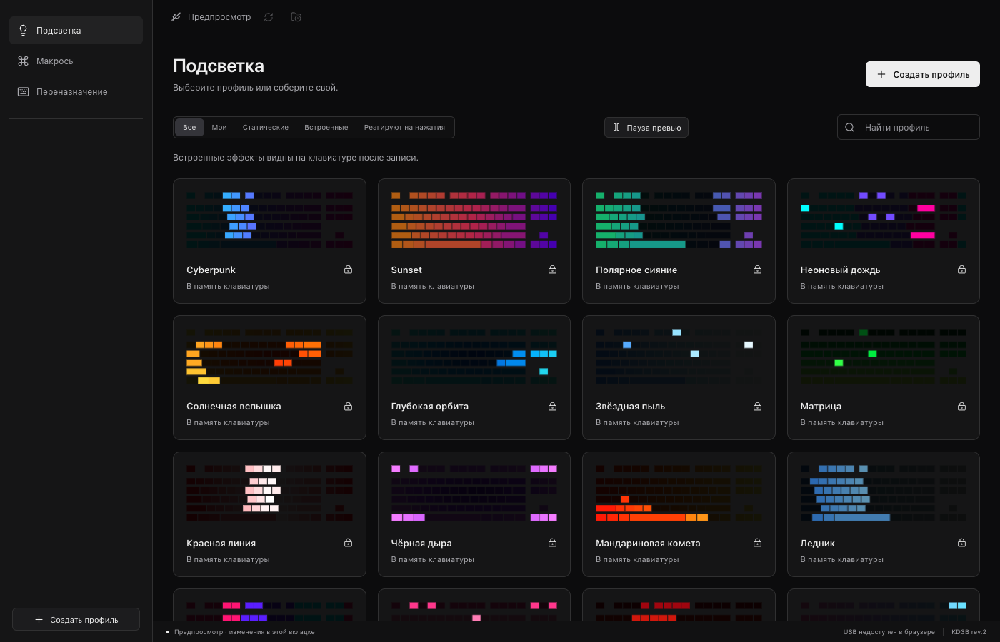
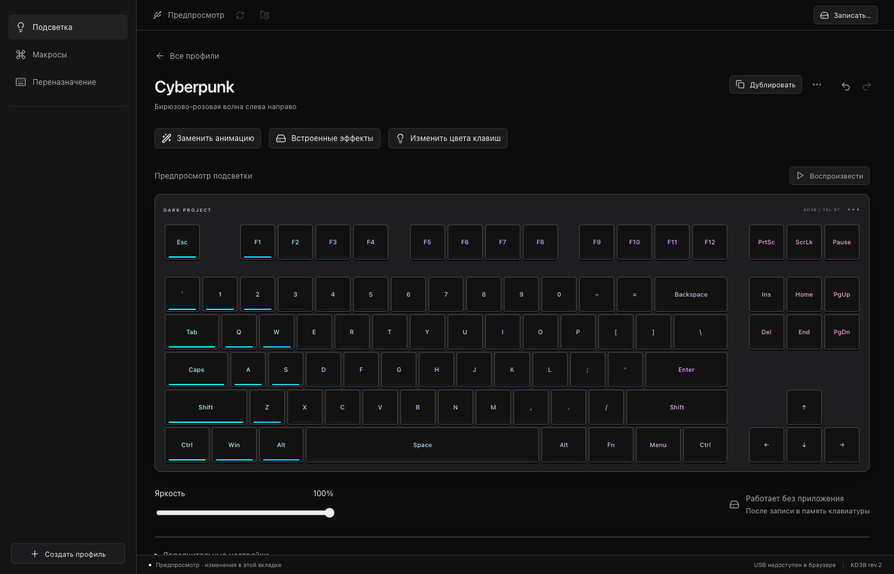

# Dark Project Studio

Lighting profiles, key remapping, and onboard macros for **Dark Project KD3B rev.2**. Settings run from keyboard memory after you close the app.

[Downloads](https://github.com/kxrxh/dark-project-studio/releases) · [Windows / macOS / Linux builds](https://github.com/kxrxh/dark-project-studio/actions)




## Build

Install Node.js 24, stable Rust, and the [Tauri prerequisites](https://v2.tauri.app/start/prerequisites/). Linux also needs `libudev-dev`.

```sh
npm ci
npm run desktop          # development
npm run tauri -- build   # native installer
```

Russian interface. Unsigned distribution builds; macOS needs Input Monitoring permission. Windows/Linux USB access needs compatible drivers and hardware verification.

[GPL-2.0-or-later](LICENSE). RGB encoding and key offsets adapted from the OpenRGB driver by Chris M (DrNo), 08 Apr 2022; attribution is preserved in [src/protocol.rs](src/protocol.rs).
